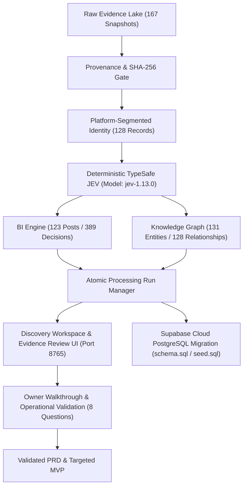

# ABANGCOLEK Intelligence & Business Discovery Engine

ABANGCOLEK ialah sistem discovery berasaskan bukti forensik untuk memahami operasi sebenar jenama **ABANGCOLEK / STYLOAIRPOOL** dan hubungan yang sedang dikaji dengan **LIURLELEH / JERUX**, sebelum membina aplikasi pengurusan bisnes (*Business OS*).

> [!IMPORTANT]
> **Status Semasa (30 September 2026):**
> Pipeline forensik telah dibina semula secara atomik (`run_20260929_160856_700991fb`), melepasi 53/53 ujian unit/regresi, diintegrasikan dengan Supabase Cloud PostgreSQL, dan dilengkapi antaramuka **Evidence Review UI** tempatan pada port `8765`. Final PRD dan Digital Twin kekal berada dalam status semakan manusia (*Human-in-the-Loop*).

---

## 🚀 Panduan Pantas (Quick Start)

Sistem kini dikendalikan sepenuhnya melalui satu antaramuka baris perintah berpusat ([src/cli.py](src/cli.py)):

```powershell
# 1. Jalankan semakan integriti persekitaran dan forensik data
python -m src.cli doctor

# 2. Periksa status run aktif dan metrik BI
python -m src.cli status

# 3. Lancarkan Discovery Workspace & Evidence Review UI (Port 8765)
python -m src.cli review --port 8765

# 4. Bina semula keseluruhan pipeline secara atomik
python -m src.cli rebuild

# 5. Jana / kemaskini fail seed PostgreSQL Supabase (1.18 MB)
python -m src.cli export-sql -o supabase_seed.sql
```

---

## 📊 Status Semasa yang Telah Disahkan (Empirical Ground Truth)

| Komponen | Status Sah | Keterangan & Rujukan Kod |
|---|:---:|---|
| **Ujian Unit & Regresi** | **53/53 PASS** (100%) | [tests/test_audit_regressions.py](tests/test_audit_regressions.py), [tests/test_supabase_and_workspace.py](tests/test_supabase_and_workspace.py) |
| **Raw Capture Snapshots** | **167 Rekod** | 100% padan dengan hash SHA-256 tersimpan; sifar sintetik dalam pengeluaran. |
| **Deduplikasi Bukti** | **128 Unik** | 39 snapshot ulangan diketepikan secara automatik tanpa memadam bukti mentah. |
| **Fail Normalisasi** | **128 Fail** | Sifar pertembungan ID; pengasingan platform SHA-256 di [src/evidence/identity.py](src/evidence/identity.py). |
| **Klasifikasi JEV System-1** | **389 Keputusan** | Model versi dipin kepada `jev-1.13.0` di [src/jev/typesafe_client.py](src/jev/typesafe_client.py); 100% cache hit pada replay. |
| **Kiraan Post BI** | **123 Posts** | Pemetaan jenis kanonikal di [src/models/record_kind.py](src/models/record_kind.py) (79 video, 2 foto, 42 post snapshot). |
| **Knowledge Graph** | **131 Entiti / 128 Relasi** | Pangkalan data SQLite [abangcolek_v4.db](data/knowledge/abangcolek_v4.db) mengandungi 389 item epistemologi & 124 peristiwa garis masa. |
| **Supabase Cloud Schema** | **11 Jadual Ber-RLS** | [src/db/schema.sql](src/db/schema.sql) siap dengan Polisi RLS, Indeks GIN/B-tree, dan Security Invoker Views. |
| **Supabase Seed Dump** | **1.18 MB (7,723 Baris)** | [supabase_seed.sql](supabase_seed.sql) dijana automatik dengan sintaks `ON CONFLICT` selamat. |
| **Evidence Review UI** | **Aktif (Port 8765)** | Pelayan REST & SPA responsif di [src/workspace/server.py](src/workspace/server.py) untuk semakan manusia. |
| **Digital Twin & Final PRD** | **GATED (In-Progress)** | Menunggu pengesahan pemilik bisnes melalui Papan 8 Soalan Operasi di UI. |

---

## 🏛️ Seni Bina Sistem



---

## 🔍 Liputan Sumber Awam (No-Key Collection)

* **TikTok (`@styloairpool`)**: 81 URL disahkan mempunyai metadata penuh (79 via `yt-dlp` + 2 via `gallery-dl`).
* **Instagram (`@airpoolstylo`)**: 11 snapshot post/reel awam.
* **Threads (`@airpoolstylo`)**: 15 snapshot post awam.
* **Calon Instagram (`@abangcolek`)**: 4 snapshot post awam (status rasmi belum disahkan).
* **Calon Reseller/Ejen (`@jeruxsliurlelehterengganu`)**: 12 snapshot post awam.

---

## 🔒 Protokol Keselamatan & Integriti Bukti

1. **Anti-Hallucination Mutlak**: Tiada data rekaan dibenarkan menggantikan data yang hilang. Ketiadaan bukti dilabel sebagai `UNKNOWN` atau `INSUFFICIENT_EVIDENCE`.
2. **Punca Masalah (Root Cause)**: Masalah produk seperti aduan kerosakan bungkusan dilabel simptomnya (`LEAKAGE` / `TASTE`), tetapi punca operasi kekal `UNDETERMINED` sehingga rekod transaksi kilang/pos diperolehi.
3. **Pemisahan Fakta vs Inferens**: Fakta mentah (*Observed Fact*), klasifikasi AI (*Classification*), dan kesimpulan (*Inference*) diasingkan dengan jelas di dalam Knowledge Graph.
4. **Sanitasi Kredensial**: Tiada kunci API atau token Git dimasukkan ke dalam repositori.

---

## 📜 Audit & Revision Ledger

| Version | Timestamp (MYT) | Author | Why | How | Validation |
|---|---|---|---|---|---|
| `4.2.0` | `2026-09-30 04:10:00` | Antigravity Sovereign Conductor | Penyelarasan penuh dengan pembaikan AC-01 hingga AC-16, Supabase, UI & CLI | Kemaskini metrik sebenar (128 records, 389 decisions, 123 posts), dokumentasi CLI, dan status UI | Pytest 53/53 PASSED; UI HTTP 200 OK |
| `4.1.0` | `2026-09-29 17:45:00` | Desktop Commander | Audit penemuan 16 kelemahan (AC-01 hingga AC-16) | Mengemas kini status penemuan awal tanpa perubahan kod | Ujian 33/33 awal lulus |
| `4.0.0` | `2026-09-29 12:10:00` | Pipeline Recovery Team | Pembersihan bukti sintetik dan penyusunan semula struktur data mentah | Kuarantin fail sintetik dan penguatkuasaan provenance | verify_integrity: PASS |
