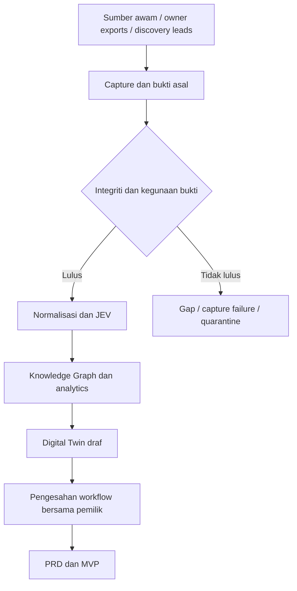

# ABANGCOLEK Intelligence & Business Discovery Engine

ABANGCOLEK ialah sistem discovery berasaskan bukti untuk memahami operasi sebenar ABANGCOLEK / STYLOAIRPOOL dan hubungan yang sedang dikaji dengan LIURLELEH / JERUX, sebelum membina aplikasi pengurusan bisnes.

**Status: foundation discovery telah wujud; pembaikan integriti dan penyelarasan output diperlukan. Business OS belum dibina. Digital Twin dan PRD akhir masih BLOCKED.**

## Mulakan di sini

- [Sintesis, audit dan pelan improvement — 29 September 2026](docs/REVIEW-SYNTHESIS-2026-09-29.md)
- Baseline yang direview: `master @ 73ae98d`.
- Review menggunakan fail, data dan ujian sebenar pada `D:\ABANGCOLEK`, melalui Desktop Commander Remote.
- Counter dan penemuan di bawah ialah snapshot audit. Laporan recovery terdahulu ialah rekod status ketika ia ditulis; ia tidak mengatasi isu yang direproduksi dalam audit baharu.

## Sintesis projek

Projek mengumpul sumber sosial/awam, owner exports dan discovery leads; menyimpan capture; menormalisasi bukti; kemudian menggunakan TypeSafe JEV untuk klasifikasi berstruktur. Kod analytics dan Knowledge Graph tersedia untuk menghubungkan bukti kepada pemahaman bisnes.

Matlamat akhirnya ialah requirement aplikasi yang disokong bukti dan pengesahan operasi dalaman. Kehadiran model ProductBatch, Incident atau Agent-related taxonomy tidak bermaksud workflow tersebut sudah disahkan.

Aliran sasaran:



Runtime `run_backfill` semasa menjalankan discovery, collection, normalization, JEV dan laporan backfill. Ia belum mengorkestrasi refresh media, BI dan Knowledge Graph.

## Status disahkan — 29 September 2026

| Komponen | Keadaan sebenar |
|---|---|
| Ujian sedia ada | **33/33 PASS** apabila dijalankan semula; belum meliputi semua bug audit |
| Skrip integriti | Melaporkan **INTEGRITY_PASS**, tetapi validator belum memeriksa seluruh kontrak provenance/hash |
| Raw capture | **167**, semuanya sepadan dengan raw payload hash tersimpan; synthetic flag **0** |
| Dedupe semasa | **128** item mengikut platform/source/collector; **39** snapshot berulang |
| Normalized | Batch melaporkan **128**, tetapi hanya **127 fail**; collision ID profil rentas platform |
| JEV tersimpan | **304 decision views**, semuanya merekod `jev-1.13.0`; tiada probe live baharu dalam review |
| Lineage normalized | **2 decision** tidak mempunyai pasangan normalized platform/hash yang tepat |
| Kiraan post | **123** rekod post/video/foto dalam normalized; BI semasa tersalah kira **0** |
| Structured comments/replies | **0**; page-level interaction labels bukan rekod perbualan sebenar |
| BI tersimpan | Output lama dengan kiraan kosong; belum refresh selepas backfill |
| Knowledge Graph | DB semasa kosong; keempat-empat jadual mempunyai **0 rekod** |
| Media v3 | **0 aset**; ASR/OCR/vision belum diimplementasikan sebagai pemproses sebenar |
| Coverage | **11 lane**, semuanya partial/blocked; `COVERAGE_READY=False` |
| Digital Twin / final PRD | **BLOCKED**, menunggu bukti mencukupi dan workflow dalaman disahkan |

304 decision bukan 304 API calls atau 304 fakta bebas. Satu bundle boleh menghasilkan beberapa views dan keputusan boleh datang daripada cache.

## Liputan semasa

- Threads `@airpoolstylo`: 15 public post snapshots.
- Instagram `@airpoolstylo`: 11 public post snapshots.
- Instagram calon `@abangcolek`: 4 public post snapshots; status rasmi belum disahkan.
- Instagram calon/reseller `@jeruxsliurlelehterengganu`: 12 public post snapshots.
- TikTok `@styloairpool`: 81 URL diketahui; 79 berjaya melalui yt-dlp dan 2 lagi melalui gallery-dl.
- Dua kegagalan yt-dlp sudah diliputi fallback gallery-dl. **81/81 URL diketahui mempunyai metadata**, tetapi bukan bukti sejarah akaun lengkap atau komen/media telah dipulihkan.
- Facebook, sejarah lebih lama, structured conversations, media sebenar dan fakta operasi dalaman masih mempunyai jurang.

## Isu utama sebelum meluaskan projek

1. **Validator terlalu longgar:** URL dan flag boleh mencukupi tanpa receipt sebenar; hash tidak dikira semula oleh gate.
2. **Collision ID:** `norm_profile_airpoolstylo.json` digunakan oleh Threads dan Instagram.
3. **Kontrak data tidak seragam:** jenis post collector tidak dikenali BI; owner export dibungkus dalam medan yang normalizer tidak baca.
4. **Kontrak JEV belum ketat:** respons kosong atau hanya model_requested boleh menjadi authoritative; taxonomy BusinessFunction tidak menawarkan UNKNOWN.
5. **Gate PRD tidak lengkap:** kod BI belum menguatkuasakan pengesahan workflow/Digital Twin.
6. **Output tidak diterbitkan sebagai satu run konsisten:** BI/graph/media stale; normalized/graph boleh menjadi separa apabila run gagal.
7. **Hash HTML berbeza pada bytes Windows:** 85 rujukan padan selepas normalisasi CRLF/LF; perlu format hash eksplisit, bukan dakwaan data dipalsukan.
8. **Setup dan schema belum kemas:** path hard-coded, tiada dependency manifest/lockfile di root, model bertindih dan default QC=PASSED pada canonical model.

Laporan audit memperincikan 16 penemuan, bukti kod, pembaikan dan acceptance criteria. Review ini mengemas kini dokumentasi sahaja; pembaikan kod belum dilaksanakan.

## Pelan seterusnya

1. Baiki integriti, identiti, record_kind, taxonomy dan kontrak JEV/PRD.
2. Tambah regression tests, staging per run, lineage dan dependency/setup yang boleh diulang.
3. Rebuild normalized, analytics dan graph daripada bukti sedia ada ke staging; validate sebelum menjadikannya run aktif.
4. Bina discovery workspace: source library, evidence viewer, claim ledger, coverage matrix dan entity review.
5. Jalankan internal discovery serentak dengan pemulihan teknikal; tambah comments/media apabila ia menjawab jurang bernilai tinggi.
6. Pilih satu workflow yang disahkan untuk MVP; tetapkan ukuran kejayaan berdasarkan baseline sebenar.

Jangan tunggu semua sejarah sosial lengkap untuk bertanya kepada pemilik tentang satu transaksi sebenar. Pada masa yang sama, jangan anggap calon modul, label JEV atau dokumen legacy sebagai requirement yang telah diluluskan.

## Peraturan bukti

- Bezakan raw evidence, observed fact, classification, inference dan hypothesis.
- Capture yang sah membuktikan apa yang ditangkap, bukan kebenaran semua dakwaan dalam kandungan.
- UNKNOWN / NOT_OBSERVED / NOT_ACCESSIBLE / INSUFFICIENT_EVIDENCE ialah hasil yang sah.
- Discovery leads perlu recapture sumber asal sebelum digunakan sebagai bukti bisnes.
- Synthetic fixtures tidak boleh masuk production evidence.
- Aduan/simptom tidak membuktikan root cause; kekalkan UNDETERMINED tanpa bukti operasi.
- `docs/legacy/`, `reports/legacy/`, `forensic_archive/` dan `data/quarantine/` ialah bahan sejarah/forensik.

## Peta dokumentasi

- [Audit dan sintesis terkini](docs/REVIEW-SYNTHESIS-2026-09-29.md) — baseline, status sebenar, isu dan pelan.
- [Recovery status](docs/RECOVERY-STATUS.md) — snapshot recovery terdahulu.
- [Architecture](docs/ARCHITECTURE.md) — reka bentuk pipeline dan sasaran downstream.
- [Evidence/JEV governance](docs/EVIDENCE-JEV-GOVERNANCE.md) — prinsip provenance dan tahap pengetahuan.
- [No-key collection](docs/NO-KEY-SOCIAL-COLLECTION.md) — collection lanes.
- [Optional social authorization](docs/SOCIAL-AUTH-SETUP.md) — API/export enrichment.
- [Implementation improvements](docs/IMPLEMENTATION-IMPROVEMENTS.md) — sejarah pemulihan.
- [Roadmap](docs/ROADMAP.md) — roadmap sebelum audit; baca bersama pelan pembaikan terkini.
- [Backfill report](reports/SOCIAL-BACKFILL-REPORT.md) — snapshot liputan terdahulu; lihat pembetulan fallback TikTok di atas.
- [Digital Twin](reports/ABANGCOLEK-BUSINESS-DIGITAL-TWIN.md) dan [PRD](reports/ABANGCOLEK-OS-PRD.md) — masih gated.

## Arahan semasa

```powershell
cd D:\ABANGCOLEK
python -m pytest -q
python -m src.scripts.verify_integrity
```

Arahan collection sedia ada ialah `python -m src.scripts.run_backfill`. Ia boleh melakukan network calls, menggunakan TypeSafe JEV dan menjalankan local-PC discovery secara automatik. Skop local discovery perlu dibaca dalam `src/scripts/local_pc_discovery.py`; jangan anggap arahan ini hanya memproses fail dalam direktori projek.

Token kekal dalam environment atau konfigurasi tempatan. Jangan masukkan token ke README, laporan atau Git.
